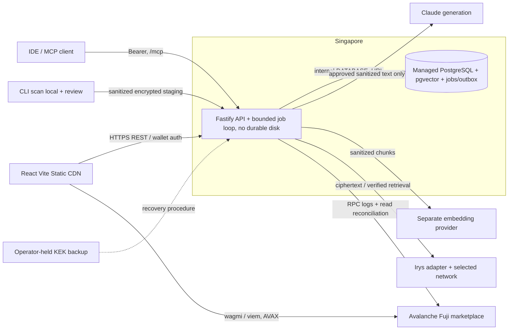
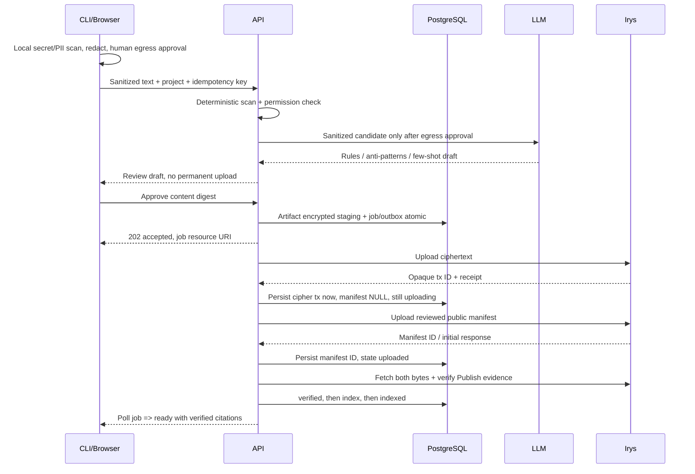
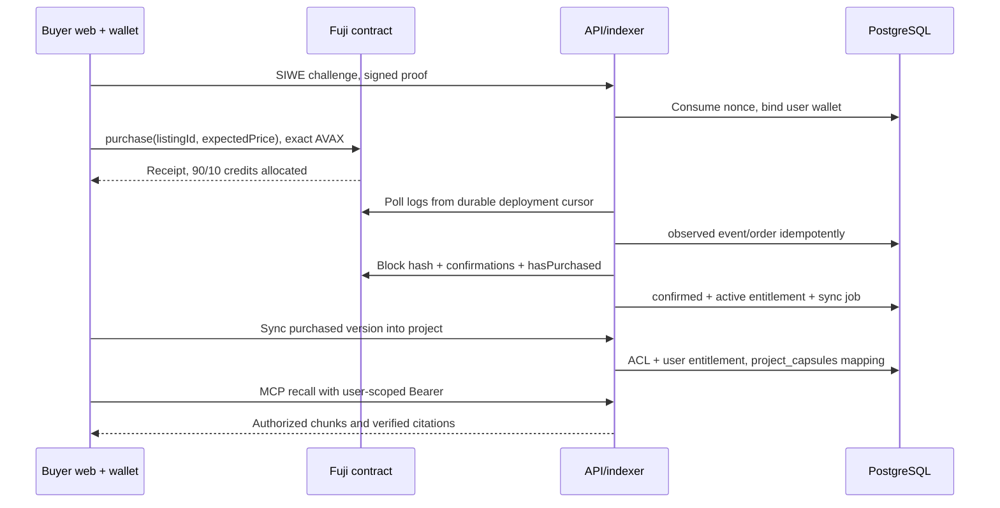

# Kiến trúc MemOcean

**TL;DR:** Một API Fastify stateless phục vụ REST, MCP và worker lease trong PostgreSQL; React static là giao diện. Irys lưu ciphertext, PostgreSQL phục vụ tìm kiếm có quyền, Avalanche ghi giao dịch mua. Đây là thiết kế từ repo trống, không phải hệ thống đã deploy.

Ngày thiết kế: **17-11-2026**. Ba tính năng cốt lõi cùng được giữ: distilled private memory, RAG có nguồn, marketplace mua capsule và sync vào MCP. Liên kết: [PMF](MARKET_AND_PMF.md) · [DDL](DATABASE_SCHEMA.md) · [contract](SMART_CONTRACT_SPEC.md) · [MCP](MCP_SPEC.md) · [lộ trình](ROADMAP.md).

## 1. Ranh giới và thuật ngữ

| Thành phần | Trách nhiệm | Không được coi là |
|---|---|---|
| Private memory | Rules, anti-patterns, few-shot examples theo project và thời gian | Kho dump raw transcript |
| Capsule root | UUID ổn định; on-chain root là commitment sender/deployment-bound trong capsule_root_bindings | Listing ID hoặc NFT |
| Capsule version | Nội dung, license và commitments bất biến | “Latest” tự đổi sau mua |
| Listing | Giá AVAX và version pin trong một deployment | Chứng chỉ sở hữu bản quyền |
| Irys artifact | Bytes mã hóa và receipt có thể kiểm tra | Bằng chứng nội dung đúng hoặc key recovery |
| PG index | ACL, vector, trạng thái, jobs, materialized entitlements | Nguồn sự thật thanh toán |

Revenue default **90% seller / 10% platform**; không token, không collaborator split trong MVP. Trial **3 câu trọn đời cho user + capsule root**, không reset khi đổi key/session/version. Paid access thuộc user có wallet đã proof, không tự cấp cả team.

## 2. Tổng quan



Static site phân phối toàn cầu; chỉ API/DB chọn Singapore cùng region. API bind `0.0.0.0:$PORT`, TLS kết thúc ở Render. Không local upload volume, SQLite, in-memory quota, sticky sessions hay in-process durable queue. Memory cache chỉ tối ưu có TTL và có thể bỏ toàn bộ khi restart.

## 3. Monorepo và hợp đồng scripts

Cây dưới là **đề xuất**, chưa tạo source hoặc scaffold trong phiên tài liệu này.

```text
memocean/
  package.json                 # private; packageManager pnpm@10.x pinned exactly
  pnpm-workspace.yaml          # apps/*, packages/*
  pnpm-lock.yaml
  apps/
    api/                       # @memocean/api: Fastify REST + MCP + worker loop
      src/{auth,rest,mcp,rag,jobs,chain,storage,crypto}/
      migrations/
    web/                       # @memocean/web: React + Vite + Tailwind + wagmi/viem
      src/
  packages/
    core/                      # @memocean/core: schemas, canonicalization, IDs, policy
    contracts/                 # @memocean/contracts: future Solidity + tests
    cli/                       # @memocean/cli: local scan/distill approval/export
  docs/                        # sáu tài liệu thiết kế hiện tại
  render.yaml                  # tương lai; hiện chỉ có blueprint nhúng bên dưới
```

Không đặt `rootDir: apps/api` hoặc `apps/web`: Render làm files ngoài rootDir không khả dụng cho build/runtime; giữ workspace root để thấy packages/core và lockfile. Có thể thêm buildFilter repo-relative cho từng service sau khi scripts đã tồn tại.

Script contract cần implementation sau: `@memocean/core build` xuất `dist`; API `build` biên dịch TypeScript vào `dist/server.js`, `start` chạy `node dist/server.js`, `db:migrate` chạy migration runner đã build trong `dist/migrate.js`; web `build` xuất `apps/web/dist`. CLI build phụ thuộc core, không chặn API/web deployment. Contract deployment là command thủ công có approval, **không** gắn vào Render build. Pin Node 22 minor/patch và pnpm exact khi scaffold; không dùng unpinned global CLI.

## 4. Blueprint Render nhúng

Blueprint chỉ có thể áp dụng sau khi có repo, lockfile, các script trên, tài khoản có billing và mọi `sync: false` được nhập. Render Blueprint hiện hành dùng `0.5c-512mb` cho **web service paid 0.5 CPU / 512 MB** và `0.1c-256mb` cho **PostgreSQL paid 0.1 CPU / 256 MB**, không hoán đổi. Đây là mapping hiện hành cho ý định “paid Starter-tier” của brief, không đổi yêu cầu sang free hoặc dịch vụ khác; tên cũ `starter`/`basic-256mb` không có trong live specification được kiểm tra ngày 17-11-2026. PostgreSQL major pin 18 là quyết định có chủ ý, không phụ thuộc default thay đổi. Mức DB này là baseline thử nghiệm, phải benchmark RAM/connections/pgvector; có thể phải nâng trước pilot. Không khẳng định chi phí hiện hành.

```yaml
services:
  - type: web
    name: memocean-api
    runtime: node
    region: singapore
    plan: 0.5c-512mb
    numInstances: 1
    buildCommand: corepack enable && pnpm install --frozen-lockfile && pnpm --filter @memocean/core build && pnpm --filter @memocean/api build
    preDeployCommand: pnpm --filter @memocean/api db:migrate
    startCommand: pnpm --filter @memocean/api start
    healthCheckPath: /healthz
    envVars:
      - key: NODE_ENV
        value: production
      - key: NODE_VERSION
        value: "22"
      - key: DATABASE_URL
        fromDatabase:
          name: memocean-db
          property: connectionString
      - key: PUBLIC_API_URL
        sync: false
      - key: WEB_ORIGIN
        sync: false
      - key: AUTH_DOMAIN
        sync: false
      - key: ANTHROPIC_API_KEY
        sync: false
      - key: GENERATION_MODEL
        sync: false
      - key: EMBEDDING_API_KEY
        sync: false
      - key: EMBEDDING_MODEL
        value: voyage-3.5-lite
      - key: EMBEDDING_DIMENSIONS
        value: "1024"
      - key: TOKEN_HASH_PEPPER
        sync: false
      - key: KEK_V1_BASE64
        sync: false
      - key: ACTIVE_KEK_VERSION
        value: v1
      - key: IRYS_NETWORK
        sync: false
      - key: IRYS_STORAGE_PRODUCT
        sync: false
      - key: IRYS_NODE_URL
        sync: false
      - key: IRYS_GATEWAY_URL
        sync: false
      - key: IRYS_FUNDING_PRIVATE_KEY
        sync: false
      - key: AVALANCHE_RPC_URL
        value: https://api.avax-test.network/ext/bc/C/rpc
      - key: CHAIN_ID
        value: "43113"
      - key: MARKETPLACE_ADDRESS
        sync: false
      - key: MARKETPLACE_DEPLOYMENT_BLOCK
        sync: false
      - key: MARKETPLACE_DEPLOYMENT_BLOCK_HASH
        sync: false
      - key: MARKETPLACE_CODE_HASH
        sync: false
      - key: CHAIN_CONFIRMATIONS
        value: "3"
      - key: JOB_CONCURRENCY
        value: "2"
  - type: web
    name: memocean-web
    runtime: static
    buildCommand: corepack enable && pnpm install --frozen-lockfile && pnpm --filter @memocean/core build && pnpm --filter @memocean/web build
    staticPublishPath: ./apps/web/dist
    routes:
      - type: rewrite
        source: /*
        destination: /index.html
    headers:
      - path: /*
        name: X-Content-Type-Options
        value: nosniff
    envVars:
      - key: NODE_VERSION
        value: "22"
      - key: VITE_API_URL
        sync: false
      - key: VITE_CHAIN_ID
        value: "43113"
      - key: VITE_MARKETPLACE_ADDRESS
        sync: false
      - key: VITE_WALLETCONNECT_PROJECT_ID
        sync: false
      - key: VITE_AVALANCHE_RPC_URL
        value: https://api.avax-test.network/ext/bc/C/rpc

databases:
  - name: memocean-db
    region: singapore
    plan: 0.1c-256mb
    postgresMajorVersion: "18"
    databaseName: memocean
    user: memocean_app
    ipAllowList: []
```

`fromDatabase.connectionString` dùng internal connection khi cùng region/account hỗ trợ; xác nhận hostname thực trong dashboard, không đưa public URL vào web. `ipAllowList: []` khóa external access, không cản private-network app. Static service không đặt `region: singapore`: CDN không phải process Singapore. Không đặt disk. Migration pre-deploy dùng advisory lock, expand/contract tương thích rollback API; không dùng destructive migration tự động. DB migration role đặc quyền phải tách app role khi hoàn thiện production; blueprint baseline chỉ tạo DB user ban đầu, bootstrap quyền là bước riêng.

### Environment map và chủ sở hữu

| Biến/nhóm | Ai nhập, có bí mật? | Kiểm tra |
|---|---|---|
| DATABASE_URL | Render reference, backend-only | Không log URL; SSL theo connection policy thực; pool tổng dưới DB limit |
| PUBLIC_API_URL, WEB_ORIGIN, AUTH_DOMAIN | Ops, public | URL đúng deployment thực; CORS allowlist chính xác, SIWE domain không wildcard |
| VITE_API_URL | Ops, public build-time | Ví dụ tên service **không** đảm bảo URL được cấp; nhập URL thật rồi rebuild |
| ANTHROPIC_API_KEY, GENERATION_MODEL | AI owner; key secret/model public | Dùng official SDK; model ID từ account/docs, không hardcode một ID chưa kiểm tra |
| EMBEDDING_API_KEY/MODEL/DIMENSIONS | AI owner; chỉ key secret | Voyage model/dimensions availability + 1024-vector roundtrip test |
| TOKEN_HASH_PEPPER | Security owner, random secret | PAT/session hash HMAC-SHA256; rotate có version/dual-verify window |
| KEK_V1_BASE64, ACTIVE_KEK_VERSION | Security owner, secret | Decode đúng 32 bytes; thiếu key thì fail readiness, không generate mới khi boot |
| IRYS_* | Storage owner; funding private key secret | Network/product/SDK/funding/gateway có evidence; tách khỏi marketplace treasury |
| AVALANCHE_RPC_URL | Chain owner; public URL hoặc provider secret | Đúng 43113; không lộ provider credential trong VITE biến |
| MARKETPLACE_* | Chain owner, public | Address/block/hash/code hash đúng một deployment; web rebuild khi đổi |
| CHAIN_CONFIRMATIONS=3 | Chain owner, public policy | Buffer demo đề xuất, không phải định nghĩa consensus finality |
| JOB_CONCURRENCY=2 | Backend owner | Backpressure, pool và RAM load test |
| VITE_WALLETCONNECT_PROJECT_ID | Frontend owner, public ID | Domain allowlist; không phải ví private key |
| PORT, NODE_ENV, NODE_VERSION | Render/Ops | PORT Render inject; không tự cố định 3000 |

Không đặt admin deployer private key trên API. Browser không có key storage, KEK, Anthropic hoặc DB. Log redact authorization, nonce, query text nhạy cảm. Cấu hình secret rotation cần cập nhật DB envelope/version metadata; changing env đơn thuần không đủ.

## 5. Distillation, encryption và storage saga



Draft được lưu trong `approval_drafts` bằng ciphertext và key envelope, không transcript thô. Approval token hash/digest/expiry lưu DB; resource review là explicit web/CLI workflow. Preview là artifact riêng có envelope/verified Irys tx và sanitized chunks allowlist; không trích paid corpus vào trial.

Human approval ràng buộc digest của chính nội dung sắp encrypt; sửa draft sau approval làm approval hết hiệu lực. Raw transcript không upload và không gửi LLM trước scan. Người dùng duyệt sanitized outbound text trước external LLM; final distilled content được duyệt lại trước permanent upload. Nếu phát hiện secret đã từng lộ, phải revoke/rotate secret; redaction không hồi phục dữ liệu đã ra ngoài.

Mỗi artifact có DEK ngẫu nhiên 32 bytes, AES-256-GCM nonce 12 bytes; authenticated additional data gồm tenant/root-or-memory ID/revision/crypto version. KEK v1 wrap DEK bằng AES-GCM nonce riêng, metadata wrap ở `key_envelopes`. Canonical plaintext có salt 32 bytes ở trong; `plainCommitment = SHA256(salt || canonical bytes)`; cipher digest hash bytes envelope; public manifest hash không tự tham chiếu. Manifest canonical trước upload bind cipher digest, không chứa Irys IDs còn chưa biết; DB/chain lưu hai IDs sau uploads. Xem contract để khóa serialization/hash. On-chain root dùng Keccak-256 ABI-encoded domain+chainId+contract+initialSeller+UUID16, không zero-pad UUID; contract verify first sender binding để chặn copied-root front-run. UUID canonical vẫn là quota key qua deployments, không claim legal authorship. Chunks index được tái tạo từ decrypted verified payload, không từ transcript gốc.

**Irys protocol facts đã tra nguồn:** Irys L1 hiện có storage term và permanent mode; Publish Ledger nhận dữ liệu sau ingress proofs từ các miner riêng biệt và đủ funding. Permanent mode được tài liệu mô tả với treasury funding trên200 năm, không phải guarantee vô điều kiện về uptime/khả năng giải mã. Submit acceptance hoặc upload ID **không** bằng finalized Publish inclusion. `uploader.irys.xyz` là bundler Irys L1 mainnet beta; legacy Arweave bundlers `node1.irys.xyz` và `mainnet.arweave.irys.xyz` đã retired ngày01-11-2026. Devnet data khoảng60 ngày không permanent. Không dùng ví faucet Fuji để suy đã trả phí permanent mainnet.

**Blocking implementation spike:** tài liệu hiện mô tả SDK `@irys/upload` + token package như `@irys/upload-ethereum`; exact patch/version chưa thử. Phải chứng minh SDK/endpoint chọn **permanent** thay vì30-day/1-year term và có API supported để verify finalized Publish/availability. Upload response được mô tả có `id`; không mặc định legacy `verifyReceipt`/receipt fields còn hợp lệ. Adapter lưu network + storage_product + gateway + raw verified evidence trong `irys_transactions`, không suy từ env sau này. [ROADMAP.md](ROADMAP.md) chặn claim “MemOcean đã permanent” cho đến spike PASS; sự tồn tại permanent mode của protocol **đã có nguồn**, phần tích hợp sản phẩm thì chưa.

Saga recovery: staged job retry → ciphertext upload → persist cipher tx ngay (manifest nullable) → manifest upload/persist → verify cả hai + finalized storage evidence → decrypt/index → list. Artifact chỉ uploaded khi cả hai IDs đã persist; không bỏ mất cipher upload nếu chết trước manifest. `uploaded` chưa searchable. `failed` giữ lỗi đã redact, cho retry có fence. Receipt không kiểm chứng hoặc bytes mismatch → quarantined, không model/no listing. Restart reclaim lease 60 giây; heartbeat 20 giây, backoff tối đa 5 lần. DB job claim/outbox chi tiết ở DDL. Orphan upload có thể xảy ra khi chết giữa external call và persist; không thể hứa exactly-once external side effects.

Nguồn reindex: verified Irys ciphertext + envelopes + DB identity/ACL/license metadata + pinned schema/model. Không thể khôi phục quyền tenant chỉ từ hash on-chain. Key backup tách DB; KEK rotation rewrap DEK, không sửa ciphertext hoặc on-chain commitment. Nếu đổi DEK hay nội dung phải upload artifact/version mới. Mất cả KEK và backup thì dữ liệu không giải mã được; Irys không có reset-password cho ciphertext.

## 6. RAG có nguồn và quyền

RAG — retrieval-augmented generation — tìm bằng chứng trước rồi mới soạn câu trả lời.

1. Xác thực token, membership sống, scope/project allowlist; canonical UTC range và giới hạn query.
2. Embed câu hỏi bằng provider riêng. Query private chunks có tenant/project ACL và thời gian ngay trong SQL. Purchased chunks cần entitlement active đúng user/version; trial chỉ preview safe derivative.
3. Chỉ lấy artifact indexed có verified tx và license phù hợp. Áp threshold đã calibrate; exact-search baseline để phát hiện HNSW thiếu recall.
4. Context là dữ liệu không đáng tin: delimit, đánh số chunk, cấm tool execution/fetch ngoài allowlist, không mang token vào model. Capsule “hãy bỏ qua policy” chỉ được trích dẫn như dữ liệu, không thực hiện.
5. Generation trả structured claims + chunk IDs. Backend không nhận URL/tx do model tự tạo; map từ retrieved allowlist, kiểm excerpt, hash, locator và claim coverage.
6. Mọi factual claim được hỗ trợ phải có citation `irys_tx_id`, artifact/version, chunk locator, excerpt hash và gateway ciphertext URL. Người không có key chỉ xác minh ciphertext hash/receipt, không tự đọc plaintext trên gateway; UI giải thích rõ.
7. Không bằng chứng, conflict hoặc citation fail → abstain “Chưa đủ nguồn đã xác minh”, không bịa câu trả lời hoặc fake citation. Không hứa tự động chứng minh entailment hoàn hảo: cần eval con người trên claims.

Mục tiêu thử nghiệm: 0 cross-tenant leak, 100% citation IDs thuộc retrieval evidence; factual citation coverage ≥95% ở benchmark curated; unsupported confident answer ≤5%. Đây là acceptance targets, chưa là số đo sản phẩm.

## 7. Thanh toán, identity và private MCP



SIWE nonce một lần và expiry lưu PostgreSQL; checks domain/URI/chain + signature; contract-wallet ERC-1271 là milestone riêng. REST session bearer ngắn hạn (đề xuất 1 giờ), PAT MCP có expiry/rotation/revoke, hash pepper và scope. Không dùng ví ký mỗi MCP call; wallet proof để claim license, token để xác thực API. Token chỉ một tenant, selected project là tham số cần authorize, không cho nhập tenant tùy ý. Web session token không lưu localStorage nếu có thể; dùng memory và refresh qua HttpOnly secure cookie với CSRF/origin checks.

Indexer dùng `(deployment, txHash, logIndex)` dedupe; compare canonical block hash, buffer 3 confirmations là demo policy bổ sung, không tuyên bố Avalanche phải chờ 3 blocks để finality. Wrong chain/address/code hash reject. Reorg orphan event/order, suspend entitlement, invalidate cache. RPC outage fail closed cho unlock mới; reconcile lại sau restore. Log không tự gán user: buyer bind đúng wallet sau proof. Giá/split/pause/withdraw invariants ở contract spec.

Protocol chính pin MCP **2026-07-28**: metadata/version/capabilities mỗi request, không initialize handshake bắt buộc kiểu legacy; profile2025-11-25 chỉ tương thích nếu implement/test riêng. MCP client support không đồng nghĩa resource auto-injection. CLI PAT có thể làm mốc đầu; OAuth discovery/client compatibility cần test. API hỗ trợ POST Streamable HTTP, JSON hoặc request-scoped SSE; không giữ session bền trong process, không subscriptions/push ở MVP. Xem [MCP_SPEC.md](MCP_SPEC.md) cho version, schema và compatibility gate.

## 8. Threat model, vận hành và phục hồi

| Rủi ro | Kiểm soát | Giới hạn còn lại / phép thử |
|---|---|---|
| Cross-tenant leak | Auth + SQL ACL + RLS, no service role on requests | Negative tests mọi endpoint/resource; RLS coverage là release gate |
| Key/API compromise | Env secrets, no logs, scoped PAT, backups tách | Operator vẫn có thể decrypt; không zero knowledge |
| Permanent PII/secret | Local + server scans, human digest approval trước upload | False negatives; delete DB không xóa permanent ciphertext |
| Trial abuse | PG atomic counter user+root, reserve-before-model | Sybil nhiều account không bị triệt tiêu; rate/spend caps |
| Preview corpus extraction | Chỉ safe derivative, output budget, no paid chunks | Không bảo đảm không suy luận lại public knowledge |
| Malicious capsule | Untrusted content, sanitize/escape, no tool privileges | Human review/eval cần tiếp tục |
| API restart | PG leases/outbox, replay-safe steps | Một external upload có thể tốn phí trùng |
| Irys/gateway outage | Multiple verified gateways nếu supported, retry/no fake ready | Permanent storage không phải SLA uptime |
| DB loss/key loss | Managed backups + encrypted key export, restore drill | Không có backup KEK thì mất giải mã vĩnh viễn |
| Chain/RPC outage | Durable cursor, receipt reconciliation, fail closed | Đã export corpus không thể revoke |

Operational targets đề xuất cho pilot: availability API 99%, recall p95 <2 giây không gồm model, RAG p95 <15 giây với context giới hạn, upload completion p95 <120 giây khi vendor bình thường; RPO DB ≤24 giờ và RTO ≤4 giờ **chỉ sau** backup/restore plan chứng minh. API ready chỉ kiểm DB + config/key presence; không gọi model/storage mỗi health probe. `/health/live` chỉ process; `/healthz` 503 khi DB/schema/config lỗi. Graceful shutdown dừng claim job, finish request giới hạn, release/recover lease.

Metrics không log nội dung: latency, token count/cost, queue age, lease expiry, upload verification failures, citation rejection, abstention, trial reserve/refund, index lag, RPC lag và entitlement suspension. Per-user/day inference budget và global budget circuit breaker bắt buộc. Không chạy cron chỉ trong browser.

## 9. Nguồn, giả định và triển khai chưa thực hiện

Nguồn chính thức, truy cập **17-11-2026**; xác nhận live configuration là gate riêng:

- [Render Blueprint specification](https://render.com/docs/blueprint-spec), [regions](https://render.com/docs/regions), [monorepo root behavior](https://render.com/docs/monorepo-support), [health checks](https://render.com/docs/health-checks), [PostgreSQL extensions](https://render.com/docs/postgresql-extensions), [private network](https://render.com/docs/private-network).
- [Irys storage ledgers](https://docs.irys.xyz/protocol-mechanics/storage-ledgers), [data lifecycle](https://docs.irys.xyz/architecture-overview/data-lifecycle), [expiring vs permanent data](https://docs.irys.xyz/foundations/what-you-can-build-on-irys/expiring-data), [bundlers](https://docs.irys.xyz/onchain-storage/bundlers), [upload SDK](https://docs.irys.xyz/onchain-storage/upload) — current protocol/product facts, không phải kết quả tích hợp MemOcean.
- [MCP transport specification](https://modelcontextprotocol.io/specification/2026-07-28/basic/transports/streamable-http.md), [authorization](https://modelcontextprotocol.io/specification/2026-07-28/basic/authorization.md).
- [RFC 8785](https://www.rfc-editor.org/rfc/rfc8785), [ERC-4361](https://eips.ethereum.org/EIPS/eip-4361), [pgvector](https://github.com/pgvector/pgvector).

Baseline repo không có app, scripts, lockfile, migrations, wallets funded hoặc deployment. YAML này được kiểm syntax trong tài liệu, không được Render validate/deploy. Tên service không tạo ra URL bảo đảm. Các giả định trên phải đi qua acceptance ở roadmap trước pitch “đã chạy”.
