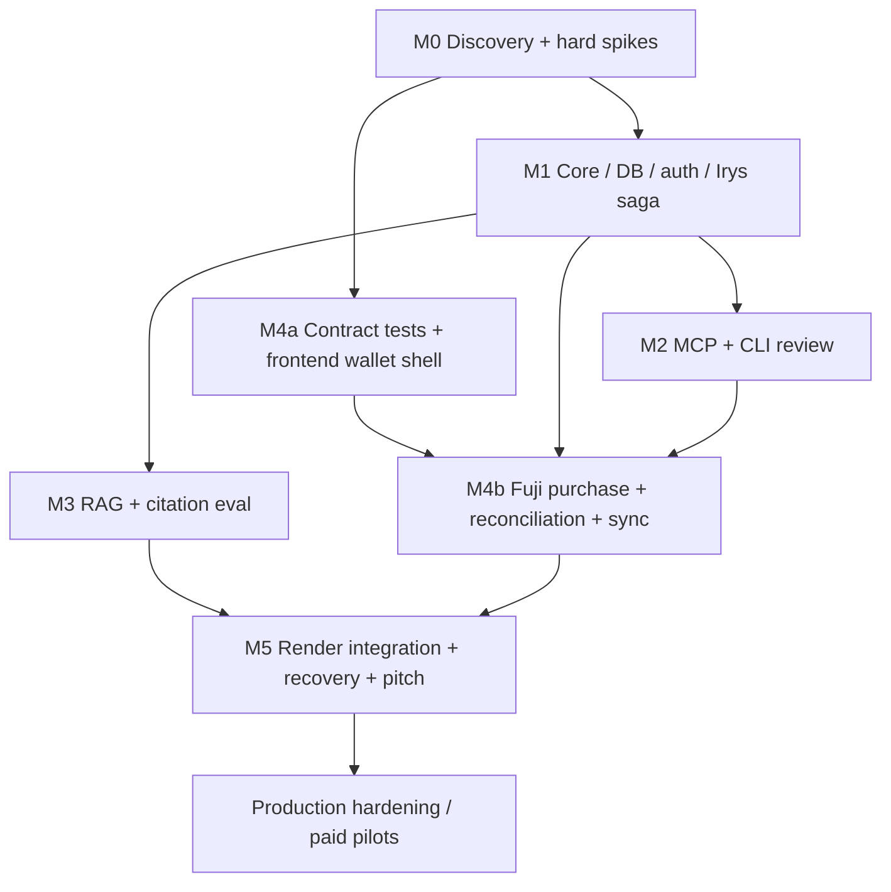

# Roadmap MemOcean — từ giả thuyết đến demo kiểm chứng được

**TL;DR:** Chốt hai spike rủi ro nhất trước: Irys permanence/verification và MCP SDK/client compatibility. Sau đó dựng một vertical slice đủ cả memory, RAG có nguồn và marketplace Fuji. Không công bố deploy, permanent storage hay PMF trước khi có evidence thật.

Baseline **17-11-2026**: repo chưa có app/contract/scaffold; chỉ sáu tài liệu thiết kế. Roadmap dùng **ngày công tương đối**, không deadline UniHack giả định. Timeline/hạng mục chấm giải, eligibility và quy tắc dịch vụ ngoài cần kiểm tra với BTC. Xem [PMF](MARKET_AND_PMF.md), [kiến trúc](ARCHITECTURE.md), [database](DATABASE_SCHEMA.md), [contract](SMART_CONTRACT_SPEC.md), [MCP](MCP_SPEC.md).

## 1. Phạm vi và người chịu trách nhiệm

Ba outcomes bắt buộc, không âm thầm bỏ khi thiếu thời gian:

1. **Permanent-memory track:** distill Rules/Anti-patterns/Few-shot từ nội dung đã scan, human review, mã hóa/upload/verify, recall theo project/time.
2. **Cited RAG track:** mọi factual answer được hỗ trợ có nguồn Irys verified; câu không có nguồn phải abstain, không bịa.
3. **Marketplace track:** thử tối đa3 câu/user/root từ preview, mua version bằng Fuji AVAX, phân bổ 90/10, unlock/sync private MCP đúng buyer.

Nếu permanence spike không PASS, demo chỉ được ghi **storage integration chưa chứng minh permanence**; không đổi nhãn testnet thành permanent để giữ pitch. Nếu core feature bị block, báo block và giảm scope phụ, không trình bày mock như live.

Vai trò đề xuất cho team 3 người, không gán tên cá nhân khi chưa có roster:

| Role | Chính | Kiêm nhiệm / reviewer |
|---|---|---|
| A — Backend/security | Auth, PostgreSQL, jobs, crypto, Irys | Recovery, deployment, RLS review |
| B — AI/product | Distill, schemas, embeddings/RAG/evals, PMF interviews | Capsule curation/license, MCP client behavior |
| C — Chain/frontend | Contract spec/tests, Fuji, React wallet UX | Revenue/receipt reconciliation review, demo |

Mỗi security-sensitive thay đổi có reviewer khác tác giả. Một người có thể kiêm role nhưng không biến acceptance thành self-assertion. Không trả tiền dịch vụ, deploy mainnet hoặc public release dữ liệu permanent khi chưa có người giữ ngân sách/consent.

## 2. Dependency graph và ước lượng

Ước lượng **không cam kết**: M0 3–5 ngày công; M1 6–9; M2 3–5; M3 4–6; M4 6–9; M5 3–5; tổng **25–39 ngày công kỹ thuật**. Ba người với coordination/review thực tế khoảng 2–4 tuần làm việc, tùy spike; discovery/outreach gần65 giờ phân bổ riêng trong PMF; mục tiêu supply100 vetted publishers là chương trình12–16tuần sau pilot, khoảng500giờ curator giả định, không nhét vào hackathon. Nếu event ngắn hơn, chỉ 1 capsule/1 project/reference client và UI tối giản, không thêm chains/payment token/admin dashboard. Không rút concurrency/security gates để lấy animation.

Song song có kiểm soát: B chuẩn bị task rubric/capsule trong lúc A spike Irys; C viết contract unit tests sau M0 commitments, không chờ RAG UI. M2 và M3 cùng dùng core schemas đã khóa; thay schema phải update cả hai. M4a và frontend wireframes không đụng DB migration của A; integration M4b phải đợi auth/deployment schema.

## 3. M0 — Discovery, quyết định và hard spikes

**Inputs:** sáu tài liệu, account có quyền vendor, budget owner, target clients, problem interview candidates. **Owner:** A/B/C cùng chốt, A dẫn technical risk. **Ước lượng:** 3–5 ngày công.

**Deliverables:**

- 5 problem interviews đầu, 1–3 task thật và baseline Git rules/docs; ghi consent, pain/no-pain và workaround, không ghi PMF.
- Irys evidence sheet: network, storage product, SDK exact version, bundler/node/gateway, funding token, supported receipt verification, upload/retrieve hash và durability terms.
- MCP evidence sheet: protocol hiện hành2026-07-28 vs target SDK/client; phân biệt per-request metadata với initialize/session-era2025-11-25; pin actual packages và auth path; POST JSON/SSE + client test.
- Render current plan mapping (`0.5c-512mb` API, `0.1c-256mb` DB, Singapore; PostgreSQL18 pin) và pgvector availability record; embedding provider/model/dimension test; monorepo script contract thống nhất.
- License/IP review checklist, public manifest/safe preview design, entropy/PII scanner choice và key custodian/backup responsibility.

**Acceptance tests:**

1. Irys upload một artifact **synthetic không nhạy cảm**, fetch lại bytes, hash khớp; phân biệt accepted/uploaded với verified storage commitment. Chứng minh được storage permanence mode phù hợp bằng SDK/node/documentation, không chỉ UI ghi “permanent”.
2. Làm rõ testnet/devnet retention và trả phí permanent network; Fuji faucet AVAX không mặc định là funding Irys mainnet. Không dùng receipt API legacy không còn supported.
3. Reference client gửi auth/header/version đúng, list/call tools, POST SSE incrementally, GET405; thử target IDE phiên bản cụ thể. SDK era nào không hợp protocol pin phải ghi incompatibility và chọn profile rõ ràng.
4. DB query `SELECT extversion FROM pg_extension WHERE extname='vector'` và availability trên PostgreSQL thực; 1024-dimension embedding request/insert/search roundtrip. Không suy iterative_scan hỗ trợ nếu chưa đo version.
5. Blueprint plan syntax/vendor validation thực khi có account; package manager pin, scripts, health và env review. Local YAML parsing chỉ syntax, không vendor deploy acceptance.

**Evidence:** vendor URL/version snapshot, redacted commands/results, tx/receipt thật nếu thực hiện, hashes, client version/config không token, service plan IDs/date, task rubric. Không tạo fake tx để lấp evidence.

**Go/no-go:** permanence mode hoặc finalized verification API chưa rõ → **BLOCKED permanence claim**, mở targeted vendor investigation; tiếp tục local schemas/contract tests không upload dữ liệu thật. MCP incompatible → reference client controlled subset và báo limitation; không hứa mọi IDE. Không có embedding dimensions đúng → đổi schema trước migration, không ép vector sai kích thước.

## 4. M1 — Core, identity, DB và encrypted Irys saga

**Inputs:** M0 storage/crypto/embedding decisions đã chốt. **Owner A**, B review payload/privacy, C review identity/licensing. **Ước lượng:** 6–9 ngày công.

**Deliverables:** pnpm monorepo, core schemas/canonicalization, Fastify health/API, SQL migrations từ [DDL](DATABASE_SCHEMA.md), auth sessions/PAT/SIWE, project ACL/RLS, draft review flow, encrypted envelopes, verified storage adapter, durable jobs/outbox.

**Acceptance:**

- Apply clean DDL trên DB tạm, migration repeat không nhân đôi; vector HNSW và model-version metadata đúng.
- Hai tenant/two users: không đọc/ghi nhầm memories/revisions/chunks/jobs/drafts/envelopes/chats; pooled connection rollback không giữ tenant context.
- Raw text bị secret scan reject trước external model; human approve digest; sửa payload làm approval invalid. Draft ciphertext/key envelope persist, restart không mất state.
- AES-GCM tamper/nonce/AAD negative tests; SHA canonicalization fixtures giống core/contract fixtures; no key trong logs/manifest/chain.
- `staged → uploading → uploaded → verified → indexed`; cipher tx persist ngay dù manifest còn NULL; restart giữa hai uploads không mất completed cipher upload; cả hai hashes/Publish evidence mới verify; upload success chưa verify không recall/list. Bytes mismatch quarantined. Retry sau restart không xuất version trùng.
- Kill API trước/sau upload response, trong verify và index; lease fencing ngăn stale worker commit, outbox dedupe/retry; không local durable files.
- Backup DB + envelope/KEK, restore encrypted synthetic artifact và reindex được. Backup không chứa raw key cùng DB dump không bảo vệ.

**Evidence:** migration/test logs, redacted DB state, real Irys receipt/hash, restore drill notes, scan test fixtures synthetic. **Go/no-go:** RLS leak, lost keys, unverified artifact searchable hoặc secret egress → stop release, sửa trước MCP/RAG public demo. Không được thay kiểm bằng “chỉ demo nên auth giả”.

## 5. M2 — MCP, CLI và review workflow

**Inputs:** M1 auth, schemas, jobs/resources. **Owner B**, A triển khai authorization/transport review. **Ước lượng:** 3–5 ngày công.

**Deliverables:** `/mcp`, bốn tools và đầy đủ schemas, resources/list/templates/read, prompts/list/get, CLI local scan/draft approval, version-pinned client configs. PAT subset trước; OAuth interoperable mode là milestone riêng nếu SDK/client yêu cầu.

**Acceptance:** mọi test trong [MCP_SPEC.md](MCP_SPEC.md), gồm server/discover exact wire shape/capabilities/supportedVersions; invalid input không gọi model; HTTP401/429 khác isError tool failure; remember returns accepted/job URI không ready citation; prompts không tự upload; resource read reauthorize mỗi request. GET/DELETE405 theo profile đã chọn; không advertise subscriptions/session replay nếu chưa implement.

Client matrix phải có **actual tested / failed / not tested**, không chung một checkmark “MCP compliant”. Record Claude Code/Cursor/Inspector versions và resource injection behavior. OAuth nếu bật phải có metadata/challenge/PKCE/audience/revocation test, không JSON discovery giả. Roll PAT với old-key revoke test; user rời project mất quyền ngay.

**Evidence:** redacted JSON-RPC transcripts, schema validator output, client screencast, restart test, token revoke test. **Go/no-go:** client không dùng resource tự động không phải bug server; tài liệu hướng dẫn explicit tool/read. Không được hứa auto memory sync trên client chưa thử.

## 6. M3 — RAG có nguồn và capsule quality

**Inputs:** verified artifacts, authorized chunks, model/provider accounts với budget cap. **Owner B**, A review ACL/citation validator. **Ước lượng:** 4–6 ngày công.

**Deliverables:** ingestion/chunking/embeddings, project/time retrieval, grounded response schema, evidence allowlist/abstention, one curated capsule + independently safe preview, web chat/library tối thiểu.

**Acceptance:**

- Exact-search baseline so HNSW filtered recall; đo index version/ef_search/fallback, không bỏ ACL để tăng recall.
- Benchmark ít nhất30 câu: 10 supported, 10 missing/conflicting/out-of-time, 10 adversarial/cross-tenant/injection. Mỗi factual supported claim có citation verified, IDs xuất phát từ retrieval không từ model fabrication.
- Mục tiêu đề xuất: citation-ID validity 100%, factual coverage ≥95%, unsupported confident answer ≤5%, cross-tenant leak0. Sample nhỏ cần human grading; không coi format-valid citation là semantic truth.
- Query không có evidence trả abstain; hash mismatch/quarantined source không được dùng. Artifact URL là ciphertext gateway; authorized plaintext view giải thích được, không hứa gateway public đọc được paid content.
- Preview chỉ derivative curated, không paid corpus; sources trỏ preview artifact verified. Token/input/output limits, injection không gọi tool/URL/secret.
- Time/project filter và latest-version conflict tests; giá trị lessons không mất khi đổi agent context.

**Evidence:** rubric, anonymized prompts/outputs/citations, verifier logs, latency/token counts, baseline comparison. **Go/no-go:** unsupported answers cao → giảm scope trả extractive evidence trước, không hạ citation requirement; không source thì abstain. Quality capsule yếu → thêm expert review, không thêm hàng trăm listing.

## 7. M4 — Fuji marketplace và private MCP sync

**Inputs:** root/version/hash convention M0, M1 identity/DB, M2 API/tool, M3 safe preview. **Owner C**, A review reconciliation, B review trial corpus. **Ước lượng:** 6–9 ngày công, phần unit contract có thể song song M1–M3.

**Deliverables:** implementation contract theo [spec](SMART_CONTRACT_SPEC.md), unit/property tests, Fuji deployment được phê duyệt và funded, web listing/quote/purchase/withdraw, indexer logs/cursor, version-pinned entitlement/project mapping.

**Acceptance:**

- Sender-bound root derivation chống copied-pending-tx namespace front-run, UUID/onchain-root mapping nhất quán, root/version immutable, exact expected price/msg.value, duplicate purchase, seller/admin permissions; fee cap/default1000bps; seller+platform credit đúng paidWei, no push payout.
- Malicious receiver/reentrancy/revert, rounding1wei, forced AVAX surplus, pause vẫn cho withdraw và access cũ; không admin drain.
- Hai wallet thật do team kiểm soát: seller list một verified version, buyer thử rồi mua, index receipt confirmed, entitlement chính xác và recall qua MCP có sources. Seller/platform balances và withdraw event kiểm được.
- Trial 100 concurrent calls: tối đa3 debit user/root tổng mọi key/version/session; same key/body1 attempt; same key/different body conflict; reserve trước model; running timeout không free retry/refund race.
- Event replay/restart không duplicate; wrong chain/contract/log bị reject; reorg simulation suspend entitlement và invalidate cache; block-hash/finality policy documented, tx hash đơn lẻ không đủ.
- Delist/new version không đổi paid version cũ; đồng đội không tự có access; buyer proof đúng wallet, không tự gửi address khác để claim.

**Evidence:** ABI/dependency locks/bytecode hash, deployment receipt + explorer URLs thật, two-wallet transactions, order/event DB samples redacted, concurrency/property test logs. **Go/no-go:** thiếu chain receipt/code binding → chưa gọi sold/unlocked; encryption key nằm on-chain hoặc paid corpus chui vào preview → stop release. Fuji purchases không ghi paid PMF.

## 8. M5 — Render, recovery và pitch

**Inputs:** M1–M4 gates PASS, ngân sách và account chủ sở hữu. **Owner A deployment, C frontend/demo, B evaluation/pitch.** **Ước lượng:** 3–5 ngày công.

**Deliverables:** blueprint thực từ [ARCHITECTURE.md](ARCHITECTURE.md), API paid Singapore + managed PostgreSQL internal + global static frontend; public URL env chính xác; deployment checklist; observability/budget caps; evidence-backed demo/pitch.

**Acceptance:**

- Actual Render plan IDs đúng tại deploy, root workspace không mất core/lockfile; build/start/migrate theo scripts; staticPublishPath đúng. API `0.0.0.0:$PORT`; health cheap DB/schema/config readiness, không LLM/Irys chain dependency.
- Static VITE_API_URL public HTTPS đúng service, CORS/auth domain match; không secret trong Vite bundle/source map/logs. DB không bị expose ra Internet ngoài chủ ý.
- POST SSE đo first-byte/incremental delivery/timeout/client disconnect qua Render thực; không suy vendor có buffering guarantee. App vẫn dùng JSON fallback nếu client được test.
- Scale API1→2 replicas hoặc mô phỏng hai processes: lease/trial/idempotency đúng không sticky session; restart mất RAM không mất durable state.
- Restore DB+KEK, reindex, replay chain cursor, trial quota không reset; RPC/Irys/model outage fail closed/abstain và recover được.
- Pilot latency/availability/RPO/RTO targets có measurements; nếu chưa đủ dữ liệu thì ghi target, không ghi SLA đạt.

**Evidence:** deployment URLs thật, build logs redacted, health/SSE/load/restart/restore results, snapshot bill estimate và budget alerts, explorer/gateway verified links. **Go/no-go:** bất kỳ core feature mocked phải gắn nhãn demo fixture; không pitch “live end-to-end”. Không mainnet launch chỉ vì demo Fuji pass.

## 9. Demo 5–7 phút, trung thực live và fixture

Chuẩn bị trước: synthetic sanitized project, approved capsule, hai wallet riêng, đủ Fuji AVAX và Irys funding đúng network; screenshots/video backup có nhãn **recorded backup**, không thay live mà không nói. Không bao giờ nhập private key/seed lên màn hình.

| Mốc | Kịch bản | Điều người xem kiểm được |
|---|---|---|
| 0:00–0:40 | Nêu một lỗi workflow cụ thể, baseline Git rules có thể làm gì | Không nói memory hiện chưa tồn tại |
| 0:40–1:50 | Scan snippet synthetic → distill rule/anti-pattern/example → human approve → remember job | Digest approval, state accepted chưa ready |
| 1:50–2:40 | Job verified/indexed, recall từ phiên client mới | Gateway tx ID thật + hash; no process-local memory |
| 2:40–3:30 | Chat một câu có evidence, rồi câu cố tình không có nguồn | Citation hợp lệ và abstention rõ |
| 3:30–4:30 | Buyer wallet thử preview; show quota tối đa3 root/user | Preview không trả toàn corpus, đổi key không reset |
| 4:30–5:40 | Wallet B purchase Fuji, receipt/explorer; 90/10 pull credits | Actual tx, amount và version commitment, không mock sale |
| 5:40–6:30 | Sync đúng buyer/project → MCP purchased recall | License version pin, seller/team khác không tự access |
| 6:30–7:00 | Nêu escrow/privacy/permanence gates và next validation | Không nhầm testnet sales với PMF/revenue |

Nếu storage upload chậm, dùng artifact đã upload **thật** trước demo và nói rõ; vẫn mở job/receipt evidence. Nếu transaction pending quá lâu, show pending và backup recording có label, không “confirmed” giả. Tránh live deployment contract trong7 phút.

## 10. Sau hackathon: readiness và business gates

Demo-ready không phải production-ready. Trước paid/mainnet pilot: independent contract/security review, OAuth interoperability, multisig/admin runbook, DR/restore drills định kỳ, license/legal/privacy terms, vendor retention/data-processing review, key custody/rotation và incident escalation. Xem private embeddings là dữ liệu nhạy cảm; muốn zero knowledge cần thiết kế mới, không đổi marketing.

KPI discovery gắn [PMF funnel](MARKET_AND_PMF.md): tách cohort discovery100 người được mời (25 interviews,12 task comparisons,8 self-return7day,4 returnweek2,2 independent paid-pilot acceptances) khỏi mục tiêu supply **100 distinct builders mỗi người ≥1 vetted published capsule**. Supply funnel giả định1.000qualified outreach→400interest→200draft→140reviewed→100published trong12–16tuần sau demo, wave10→30→100 và khoảng500giờ curator; không đếm invitations như publishers. Growth loop đo successful reuse→seller income/referrals→tested Avalanche integration capsules→new builders, không speculation/wallet inflation. Tất cả là targets giả định, báo counts thực/denominators/refusals. Paid inference model phải contribution dương sau tokens/embeddings/storage/infra/support/abuse, không chỉ 10% marketplace fee gross. Review product kill/pivot thresholds trước thêm chains/supply.

## 11. Sổ evidence và kiểm tra tài liệu hiện tại

Mỗi milestone tương lai lưu evidence theo issue/task ID: command/version/date, expected vs actual, redacted output, reviewer, limitations. Không cần tạo các report này trong repo trống ở bước thiết kế. Sáu Markdown là toàn bộ deliverables hiện tại.

Kiểm có thể chạy ngay: JSON fences parse, JSON Schema 2020-12 meta-validation, YAML parse, local Markdown links, shared constants/tên bảng. **Chưa thể thay thế:** SQL execution, Solidity compile/tests/audit, SDK installation/compatibility, Irys funding/upload/finality, Render deploy/SSE, embedding/model calls, wallet transactions và PMF research thực. Các dependency còn mở làm trạng thái tổng là **DESIGN READY, IMPLEMENTATION/VALIDATION PENDING**, không launch-ready.

Nguồn technical chính thức và ngày được dẫn ở từng tài liệu; roadmap không tạo vendor guarantee mới. Vendor facts cần recheck ngay trước implementation vì protocol/network/plan IDs có thể đổi.
